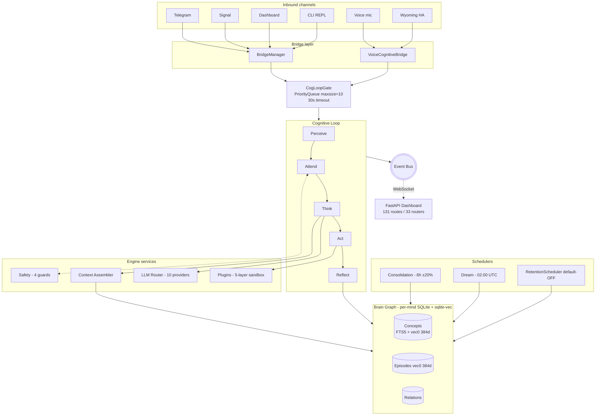
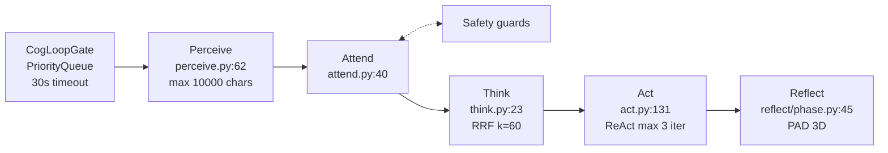
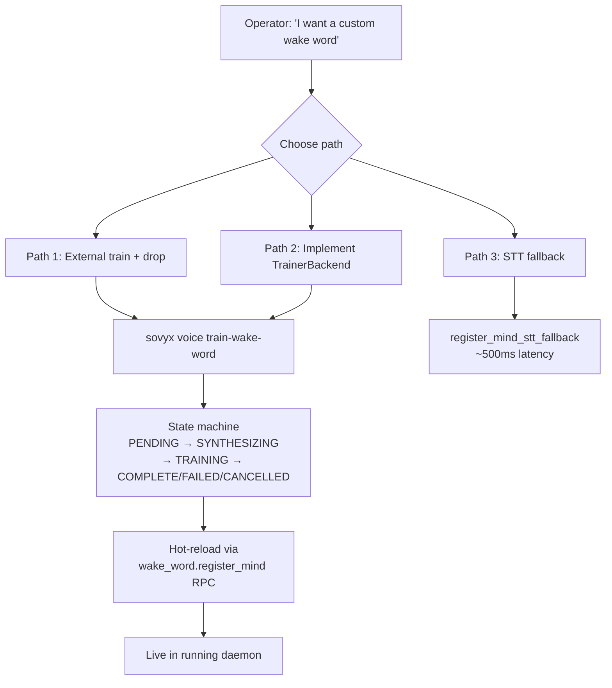
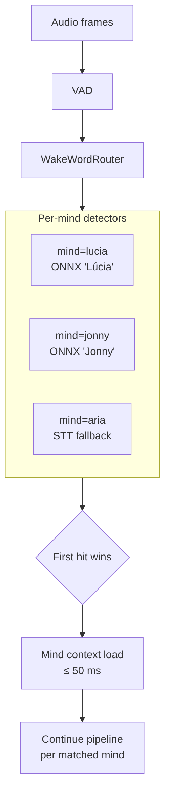
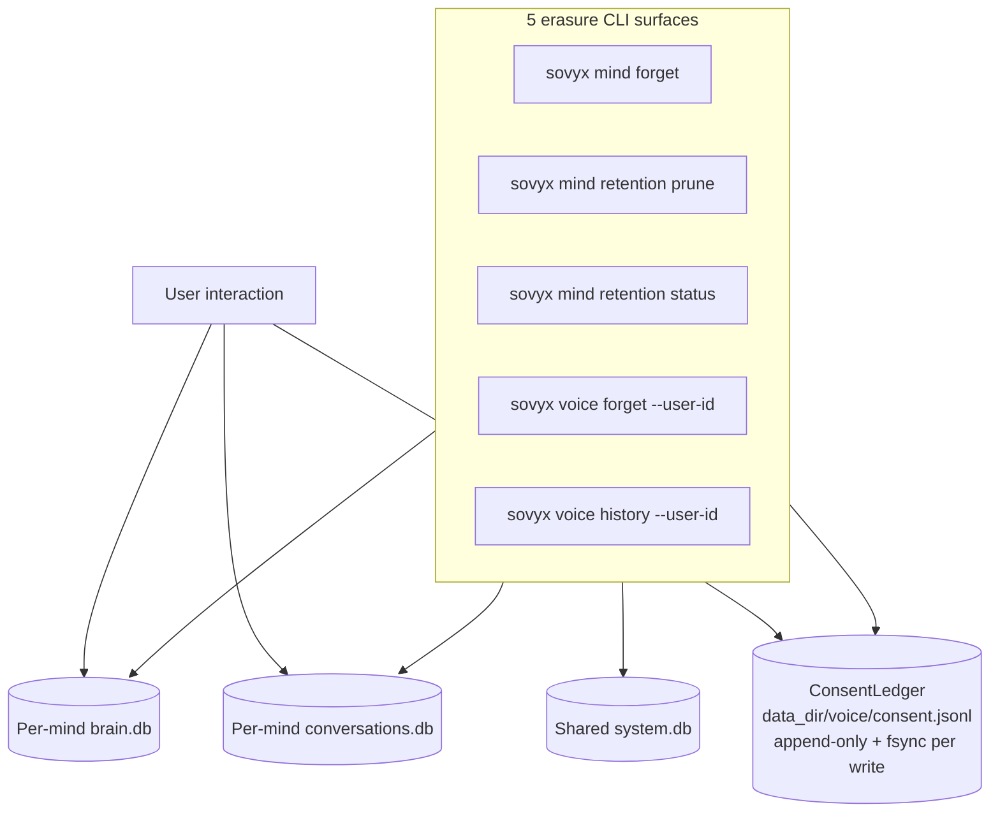

<p align="center">
  <picture>
    <source media="(prefers-color-scheme: dark)" srcset="docs/_assets/sovyx-wordmark-accent.svg">
    <source media="(prefers-color-scheme: light)" srcset="docs/_assets/sovyx-wordmark-bw.svg">
    
  </picture>
</p>

<p align="center">
  <strong>可自行架設的 AI 夥伴：具備持久記憶、多心智語音路由，以及七階段認知迴圈。</strong><br>
  本機優先。AGPL-3.0。你的硬體、你的資料。預設零遙測。
</p>

<p align="center">
  <a href="README.md">English</a>
</p>

<p align="center">
  <a href="https://github.com/sovyx-ai/sovyx/actions/workflows/ci.yml"></a>
  <a href="https://pypi.org/project/sovyx/"></a>
  <a href="https://pypi.org/project/sovyx/"></a>
  <a href="https://github.com/sovyx-ai/sovyx/blob/main/LICENSE"></a>
  
  
  
</p>

<p align="center">
  <a href="#2-為什麼選擇-sovyx">為什麼</a> &middot;
  <a href="#3-快速開始">快速開始</a> &middot;
  <a href="#4-安裝指南">安裝</a> &middot;
  <a href="#5-系統架構">架構</a> &middot;
  <a href="#9-語音子系統">語音</a> &middot;
  <a href="#10-喚醒詞訓練逐步說明">訓練</a> &middot;
  <a href="#11-多心智架構">多心智</a> &middot;
  <a href="#15-命令列參考">命令列</a> &middot;
  <a href="#22-路線圖">路線圖</a>
</p>

> 本頁是 [README.md](README.md) 的繁體中文譯本。指令、路徑、設定鍵與程式識別名稱維持英文。若譯文與英文原文有出入，以英文 README 為準。

---

## 2. 為什麼選擇 Sovyx

Sovyx 是一套**應用程式**，不是框架。它以常駐程式跑在你自己的硬體上，用你自己的 API 金鑰對接 10 家大型語言模型供應商，並把對話寫進大腦圖譜；你睡覺時，圖譜仍會整理記憶。不強制上雲、沒有遙測、原始碼採 AGPL-3.0。

### 它和別人不一樣的地方

- **真正的持久記憶。** 大腦圖譜存在 SQLite 與 sqlite-vec 裡，檢索是混合式的（KNN + FTS5 + Reciprocal Rank Fusion，k=60）。Hebbian 共活化會加強連結（`new_w = min(1.0, old + lr × (1 − old) × co)`），Ebbinghaus 遺忘會降低重要性（`new_imp = imp × (1 − decay × 1/(1 + access × 0.1))`），情緒用 PAD 三維模型（愉悅 Pleasure、喚起 Arousal、支配 Dominance）。這不是一堆向量傾倒，而是一套認知架構。
- **多心智語音路由。** 每個心智有自己的喚醒詞、聲線、口音、語言、保留政策與記憶池。`WakeWordRouter` 同時跑 N 個 ONNX 偵測器（每個已啟用心智一個）；先命中者勝出；心智脈絡在 `<= 50 ms` 內載入。跨心智隔離由 Hypothesis 性質測試釘住：`tests/property/test_cross_mind_isolation_t820.py`。
- **語音能撐過 Voice Clarity APO 與 Krisp。** Windows 有三層旁路協調器（RAW／主機 API 輪換／WASAPI 獨佔），Linux 有混音器知識庫設定檔，冷探測會檢查訊號能量，拒絕「回呼有觸發但 PCM 正好是零」的假健康。預設裝置變更有 IMM 通知監聽。細節記在 14 份鑑識 Furo 裡。
- **預設不回傳任何資料。** `voice_telemetry: bool = True` 是**內部可觀測閘門**（給操作者儀表板的日誌與指標）。社群遙測必須同時滿足 `voice_community_telemetry_enabled=True` 且 `voice_community_telemetry_endpoint` 非空才會送出（`engine/config.py:418, 430`）。預設關閉的契約已核對。
- **從 Pi 5 到機架伺服器。** 開機時自動選擇器會探測主機（`voice/auto_select.py`），挑一組放得進該等級的 ONNX 組合（Pi 5／N100／桌面 CPU／桌面 GPU）。同一份程式碼、同一套設定。

### 信任模型

| 介面 | 信任方式 | 強制手段 |
|------|----------|----------|
| 常駐程式 ↔ 命令列 RPC | 本機 UDS（Linux／macOS，權限 `0o600`）或 TCP 迴環（Windows，暫時連接埠） | 檔案權限 + 只允許迴環 — 傳輸層沒有權杖 |
| 儀表板 HTTP | Bearer 權杖放在 `sessionStorage`（絕不放 `localStorage`，反模式 #19） | 每個請求用 `verify_token` 做常數時間比較 |
| WebSocket（`/ws`、`/api/voice/test/input`） | 查詢參數裡的權杖 + `secrets.compare_digest` | 瀏覽器在 WebSocket 升級時無法設定 `Authorization` |
| 外掛沙箱 | 5 層（AST 掃描 + 匯入守衛 + 沙箱 HTTP + 沙箱檔案系統 + 能力權限） | 單一外掛被拒絕 10 次後自動停用 |
| 語言模型供應商金鑰 | 只存在 `os.environ`，從不寫入磁碟 | 密鑰檔由操作者保管 |
| Wyoming（Home Assistant 語音助理） | 可選 HMAC 權杖；沒有權杖就拒絕非迴環綁定 | 預設信任區域網路，可設定 |

---

## 3. 快速開始

### 60 秒打招呼（純文字）

```bash
pip install sovyx
export ANTHROPIC_API_KEY=sk-ant-...   # 或 10 家支援供應商中的任何一家
sovyx init my-mind
sovyx start
```

```
[info] dashboard_listening       url=http://localhost:7777
[info] bridge_started            channels=1
[info] brain_loaded              concepts=0 episodes=0
[info] cognitive_loop_ready      mind=my-mind
```

打開 `http://localhost:7777`，執行 `sovyx token --copy` 取得驗證權杖，貼上後即可聊天。

### 5 分鐘語音（單一心智）

```bash
# 1. 安裝語音額外依賴
sudo apt-get install -y libportaudio2     # 僅 Linux — macOS：brew install portaudio；Windows：已隨套件附帶
pip install "sovyx[voice]"

# 2. 設定金鑰並啟動
export ANTHROPIC_API_KEY=sk-ant-...
sovyx init my-mind
sovyx start

# 3. 在儀表板點「Enable Voice」。常駐程式會探測硬體、
#    選擇 ONNX 等級並開始收音。直接跟它說話即可。

# 4.（Linux，可選）若麥克風一直沒聲音 — 筆電出廠混音器預設被壓低時很常見
#    （例如 Sony VAIO + PipeWire）— 執行：
sovyx doctor voice --calibrate --non-interactive    # 8–12 分鐘自動修復
#    校正精靈會擷取硬體指紋、跑完整鑑識診斷、依你的硬體選對規則（R10..R95），
#    並自動套用修復。設定檔寫到
#    ~/.sovyx/<mind_id>/calibration.json。之後可隨時從儀表板
#    Settings → Voice 重新校正。見 `docs/getting-started.md`。
```

自動選擇器會挑 Moonshine 語音轉文字、Piper 文字轉語音、SileroVAD，以及適合你硬體的 ONNX 喚醒詞模型。預設喚醒詞是 `"Sovyx"`。

### 30 分鐘多心智（完整表面）

```bash
# 1. 為第二個心智訓練自訂喚醒詞
sovyx voice train-wake-word "Lúcia" \
    --mind-id lucia --language pt-BR \
    --target-samples 200 \
    --negatives-dir ~/voice-corpus/negatives

# 2. 在 ~/.sovyx/lucia/mind.yaml 設定該心智的語音
# （完整結構見第 11 節）

# 3. 訓練完成後會自動熱重載
#    （命令列會呼叫 wake_word.register_mind RPC）。
```

此時 `"Sovyx"` 與 `"Lúcia"` 可以同時運作。`WakeWordRouter` 平行跑兩組偵測器；先命中者勝出；對應心智的脈絡在 `<= 50 ms` 內載入。

---

## 4. 安裝指南

### 可選依賴群組（`pyproject.toml [project.optional-dependencies]`）

| 額外套件 | 會拉入 | 用途 |
|----------|--------|------|
| `voice` | `moonshine-voice>=0.0.50`、`piper-tts>=1.4`、`sounddevice>=0.5`、`kokoro-onnx>=0.4`、`scipy>=1.11`、`comtypes>=1.4`（僅 Windows）、`pyaec>=1.0` | 語音轉文字 + 文字轉語音 + 音訊輸入輸出 + 訊號處理 + Windows IMM 監聽 + Speex 回音消除後備 |
| `voice-quality` | `speechmos>=0.0.1.1`、`librosa>=0.11` | 可選的 DNSMOS／AEC-MOS／PLC-MOS 感知品質估計（傳遞依賴約 100 MB） |
| `plugins` | `watchdog>=4.0` | 外掛模組的檔案系統熱重載 |
| `search` | `trafilatura>=2.0` | 以額外套件名稱重新暴露核心的 trafilatura |
| `otel` | `opentelemetry-exporter-otlp>=1.20`、`opentelemetry-instrumentation-httpx>=0.41b0` | OTLP 匯出器 + httpx 自動埋點 |
| `dev` | `pytest`、`pytest-asyncio`、`pytest-cov`、`pytest-timeout`、`hypothesis`、`mypy`、`ruff>=0.15,<0.16`、`bandit`、型別存根 | 測試／檢查／型別檢查工具鏈 |

### 原生依賴（依作業系統）

| 函式庫 | 誰使用 | Ubuntu／Debian | Fedora／Arch／Alpine | macOS | Windows |
|--------|--------|----------------|----------------------|-------|---------|
| PortAudio | `sounddevice`（語音） | `apt-get install libportaudio2`（CI 已驗證） | 上游套件 | `brew install portaudio`（CI 已驗證） | 已包在 `sounddevice` 輪檔裡，不必另外安裝 |
| espeak-ng（可選） | `voice/_phonetic_matcher.py` 做喚醒詞音素比對（T8.12） | `apt-get install espeak-ng` | 上游套件 | `brew install espeak-ng` | 上游 Windows 安裝程式 |

`espeak-ng` **可選** — 沒裝時會落到語音轉文字偵測器（`_phonetic_matcher.py:10-18`）。Linux／macOS 要用語音就必須有 PortAudio。

### Python 與持續整合

- `requires-python = ">=3.11"`（`pyproject.toml:11`）
- CI 矩陣：Linux `{3.11, 3.12}`、Windows `3.12`、macOS `3.12`（不對稱，見 `.github/workflows/ci.yml:121-135`）
- Trove 分類只列 `Python :: 3.11`、`Python :: 3.12`

### 建議安裝路徑

```bash
# 等級 1 — 只有核心（沒有語音、沒有外掛熱重載）
pip install sovyx

# 等級 2 — 核心 + 語音
sudo apt-get install -y libportaudio2          # 僅 Linux
pip install "sovyx[voice]"

# 等級 3 — 完整維運安裝
pip install "sovyx[voice,voice-quality,otel,plugins,search]"

# uv（開發建議）
uv tool install sovyx --with "sovyx[voice]"

# pipx（隔離環境）
pipx install "sovyx[voice]"

# Docker（僅核心 — 官方映像不含語音額外套件）
docker pull ghcr.io/sovyx-ai/sovyx:latest
# 要用語音的操作者必須自行延伸映像。
```

### 檢查安裝

```bash
sovyx doctor                         # 一般安裝健康
sovyx doctor voice --json            # 語音子系統深度探測
sovyx doctor cascade                 # 啟動自我診斷
sovyx doctor platform                # 跨作業系統功能矩陣
```

---

## 5. 系統架構



### 模組地圖（頂層套件）

| 套件 | 規模 | 用途 |
|------|------|------|
| `engine/` | 中 | 啟動、生命週期、登錄表、JSON-RPC 伺服器、錯誤、事件、型別、設定 |
| `cognitive/` | 中 | 七階段迴圈（5 個請求驅動 + 2 個排程器）、4 道安全守衛、閘門 |
| `brain/` | 中 | 概念／情節／關係 + 檢索 + Hebbian + 鞏固 |
| `voice/` | 約 80 000 行 | 收音、管線、喚醒詞、多心智路由器、訓練、旁路等級 |
| `llm/` | 小 | 路由器 + 10 家供應商 + 斷路器 + 成本上限 |
| `bridge/` | 小 | BridgeManager + Telegram／Signal／Wyoming／儀表板聊天轉接器 |
| `plugins/` | 中 | SDK + 五層沙箱 + 7 個官方外掛 + 熱重載 |
| `dashboard/` | 中 | FastAPI 伺服器 + 33 個路由器模組 + 131 個端點 |
| `mind/` | 小 | MindConfig + 每個心智的保留與遺忘 |
| `observability/` | 中 | structlog + OpenTelemetry（96 個儀器）+ 環形緩衝 + 5 個服務水準目標 + 10 項健康檢查 |
| `persistence/` | 小 | SQLite 連線池 + WAL + 每個心智隔離 |
| `upgrade/` | 小 | 醫師診斷 + 匯入器 + 藍綠 + 備份 |
| `cli/` | 小 | Typer 命令列 — 根生命週期指令 + 10 個子應用 |

合計 **589 個原始檔**，`mypy --strict` 乾淨，所有嚴重度的 `bandit` 問題為零。

---

## 6. 認知迴圈



### 五個由請求驅動的階段

| 階段 | 模組 | 預算 |
|------|------|------|
| **Perceive（感知）**（`perceive.py:62`） | 正規化輸入、綁定頻道脈絡、建立 `Perception` | 每則輸入最多 10 000 字元 |
| **Attend（注意）**（`attend.py:40`） | 顯著性評分、安全預檢 | — |
| **Think（思考）**（`think.py:23`） | 以 RRF 檢索組裝脈絡（k=60）、呼叫語言模型、串流 | 語言模型安全分類器 2 秒 |
| **Act（行動）**（`act.py:131`） | ReAct 迴圈、外掛工具呼叫、財務確認 | 最多 3 次 ReAct 迭代；財務 300 秒 |
| **Reflect（反思）**（`reflect/phase.py:45`） | 概念抽取（PAD 三維情緒）、情節編碼、Hebbian 共活化、寫回大腦 | — |

### 安全守衛（`cognitive/safety/`）

| 守衛 | 檔案 | 做什麼 |
|------|------|--------|
| **PIIGuard** | `pii_guard.py:277` | 輸出遮罩，格式為 `[REDACTED-<TYPE>]` |
| **InjectionContextTracker** | `injection_tracker.py:294` | 多輪注入偵測（視窗=5，門檻=1.5） |
| **OutputGuard** | `output_guard.py:72` | 正則 + 語言模型級聯，依等級遮罩或替換 |
| **FinancialGate** | `financial_gate.py:263` | 在 ReAct 迴圈內攔截 `tool_calls`，用行內按鈕確認 |

模式目錄按語言拆開（`safety/patterns_en.py`、`patterns_pt.py`、`patterns_es.py`、`patterns_child_safe.py`）。

### 背景排程器

| 排程器 | 節奏 | 做什麼 |
|--------|------|--------|
| **Consolidation（鞏固）**（`brain/consolidation.py:533`） | 每 6 小時 ±20% 抖動 | 衰減並合併概念、刷新重心、修剪低重要性 |
| **Dream（夢境）**（`brain/dream.py:420`） | 每日 02:00 UTC | 跨情節抽取模式 |
| **RetentionScheduler**（`mind/retention.py:549`） | 可設定（每個心智預設關閉） | 依 `MindConfig.retention.*_days` 做時間修剪 |

### 每個階段的可觀測性

三組延遲直方圖涵蓋迴圈：`sovyx.cognitive.latency`（整圈）、`sovyx.cognitive.phase_latency{phase}`（每個階段，5 個封閉集合值）、`sovyx.safety.filter.latency`（帶方向標籤）— 全部在 `observability/metrics.py` 建立。每個階段的追蹤 span 與直方圖並存。操作者可調的預算在 `EngineConfig.tuning`。

---

## 7. 大腦圖譜

### 結構（依 `persistence/schemas/brain.py:15-125`）

| 實體 | 儲存 | 向量？ | FTS5？ | 按心智？ |
|------|------|--------|--------|----------|
| Concept | `concepts` 表 | 是（sqlite-vec `vec0(... FLOAT[384])`） | 是 | 是（`mind_id` 欄） |
| Episode | `episodes` 表 | 是（vec0 384 維） | 否 | 是（`mind_id` 欄） |
| Relation | `relations` 表 | 否 | 否 | 是（經由外鍵連到 `concepts.mind_id`） |

### 檢索演算法

`brain/retrieval.py` 實作混合檢索：

1. **sqlite-vec 的 KNN** — 依向量相似度取前 K 名
2. **FTS5 關鍵字** — 依 BM25 取前 K 名
3. **Reciprocal Rank Fusion** — `Σ 1.0 / (k + rank_pos + 1)`，`k=60`，見 `retrieval.py:47, 264, 270`
4. **品質加權** — `0.60 * importance + 0.40 * confidence`，見 `retrieval.py:276-279`

沒有 sqlite-vec 時，檢索器退回只用 FTS5。

### 嵌入模型

- **模型：** E5-small-v2（384 維）
- **SHA256：** `4b8205be...4fdcba`（`brain/_model_downloader.py:42-45`）
- **鏡像：** HuggingFace 為主，GitHub Releases 為後備

### 記憶動態

| 機制 | 公式 | 檔案 |
|------|------|------|
| Hebbian | `new_weight = min(1.0, old + lr × (1 − old) × co_activation)` | `learning.py:36-37` |
| Hebbian 拓樸 | 星狀（跨回合共活化） | `learning.py:103` |
| Ebbinghaus 遺忘 | `new_imp = imp × (1 − decay × 1/(1 + access × 0.1))` | `learning.py:321-322` |
| 衰減旋鈕 | `forgetting_enabled: bool = True`、`decay_rate: float = 0.1`、`min_strength: float = 0.01` | `mind/config.py:226-228` |

### 跨心智隔離

每個儲存庫查詢都帶 `WHERE mind_id = ?`。性質測試 `tests/property/test_cross_mind_isolation_t820.py` 釘住契約：

```python
forall (mind_a, mind_b, action) ⇒ no leak from a to b
```

涵蓋 `ConceptRepository.get_by_mind`、`EpisodeRepository.get_recent`／`get_since`、`ConsentLedger.history`／`forget`。

---

## 8. 語言模型路由器

### 10 家供應商

| 供應商 | 模組 | 環境變數 | 工具 | 串流 | OpenAI 相容 |
|--------|------|----------|------|------|-------------|
| Anthropic | `providers/anthropic.py` | `ANTHROPIC_API_KEY` | 是（原生） | 是 | 否（專用協定） |
| OpenAI | `providers/openai.py` | `OPENAI_API_KEY` | 是（原生） | 是 | 是（正典） |
| Google | `providers/google.py` | `GOOGLE_API_KEY` | 是（原生） | 是 | 否（專用協定） |
| xAI | `providers/xai.py` | `XGROK_API_KEY`（注意：不是 `XAI_API_KEY`） | 經 OpenAI 相容 | 是 | 是 |
| DeepSeek | `providers/deepseek.py` | `DEEPSEEK_API_KEY` | 經 OpenAI 相容 | 是 | 是 |
| Mistral | `providers/mistral.py` | `MISTRAL_API_KEY` | 經 OpenAI 相容 | 是 | 是 |
| Together | `providers/together.py` | `TOGETHER_API_KEY` | 經 OpenAI 相容（模型識別必須有 `org/` 前綴） | 是 | 是 |
| Groq | `providers/groq.py` | `GROQ_API_KEY` | 經 OpenAI 相容 | 是 | 是 |
| Fireworks | `providers/fireworks.py` | `FIREWORKS_API_KEY` | 經 OpenAI 相容 | 是 | 是 |
| Ollama | `providers/ollama.py` | `OLLAMA_HOST`（網址） | 是（Ollama 原生） | 是 | 否（專用協定） |

**視覺：** 目前 HEAD 沒有任何供應商暴露影像輸入。在 `src/sovyx/llm/` 搜尋 `vision|image|multimodal` 沒有相符。

### 複雜度分級路由器（`llm/router.py`）

| 等級 | 觸發（預設） | 操作者可調 |
|------|--------------|------------|
| Simple | `長度 ≤ 500 字元` 且 `回合 ≤ 3` | `tuning.llm.simple_max_length`、`simple_max_turns` |
| Complex | `長度 ≥ 2000 字元` 或 `回合 ≥ 8` | `tuning.llm.complex_min_length`、`complex_min_turns` |
| Moderate | （其餘情況） | — |

### 成本上限

| 上限 | 預設 | 來源 |
|------|------|------|
| 每日 | 2.00 美元 | `MindConfig.llm.budget_daily_usd`（`mind/config.py:67`） |
| 每段對話 | 0.50 美元 | `MindConfig.llm.budget_per_conversation_usd`（`mind/config.py:68`） |

狀態寫入 SQLite `engine_state` 鍵 `cost_guard_state`（`llm/cost.py:28`）。`generate` 與 `stream` 兩條路徑都在起飛前強制檢查（`router.py:301-307, 552-558`）。

### 斷路器

預設失敗門檻 3、半開成功門檻 1、重設 60 秒。**漂移註記：** `LLMProviderConfig.circuit_breaker_reset_seconds=300` 有定義，但路由器沒有讀它（`engine/bootstrap.py:550-554` 以預設 60 秒呼叫）。

### 跨供應商容錯

開機時供應商輪換順序：anthropic → openai → google → xai → deepseek → mistral → groq → together → fireworks → ollama（`engine/bootstrap.py:441-485`）。

**已記載的限制：** 串流**沒有中途容錯**。供應商輪換只在第一個區塊之前觸發（`router.py:526-529`）。第一個區塊之後，錯誤會傳給呼叫端。

---

## 9. 語音子系統

```mermaid
flowchart LR
    MIC[Mic] --> CAP[AudioCaptureTask<br/>5-mixin composition]
    CAP --> BYP[Bypass coordinator<br/>3 Win tiers + 3 Linux strategies]
    BYP --> RING[Ring buffer<br/>epoch-versioned]
    RING --> VAD[SileroVAD v5<br/>32ms @ 16kHz]
    VAD --> ROUTER[WakeWordRouter<br/>N detectors]
    ROUTER --> DISP[Mind dispatch<br/>≤ 50 ms]
    DISP --> STT[Moonshine STT]
    STT --> LOOP[Cognitive Loop]
    LOOP --> TTS[Piper / Kokoro TTS<br/>filler 800ms]
    TTS --> OUT[Output queue<br/>+ mic ducking -18dB]
```



### 收音路徑

`AudioCaptureTask`（`voice/_capture_task.py:214`）依反模式 #16 組成 5 個 mixin（巨型檔案拆分，2785 行 → 830 行）：

| Mixin | 行數 | 職責 | 檔案 |
|-------|------|------|------|
| `EpochMixin` | 66 | 40 位元打包的環形紀元 + 原子標記 | `_epoch.py` |
| `RingMixin` | 256 | 環形緩衝狀態 + 分接輔助 | `_ring.py` |
| `LifecycleMixin` | 160 | 串流開啟／關閉／停機 | `_lifecycle_mixin.py` |
| `LoopMixin` | 450 | 音訊執行緒 + 消費迴圈 | `_loop_mixin.py` |
| `RestartMixin` | 1549 | 5 種重啟策略（獨佔、共用、ALSA 硬體直連、工作階段管理器、主機 API 輪換、裝置變更） | `_restart_mixin.py` |

影格格式：16 位元 PCM、16 kHz、每影格 512 個樣本（32 毫秒）。

### Voice Clarity APO 旁路等級（Windows）

Voice Clarity（`VocaEffectPack`，CLSID `{96BEDF2C-18CB-4A15-B821-5E95ED0FEA61}`，隨 Win11 25H2 累積更新出貨）會註冊成每個端點的收音 APO，在受影響硬體上毀掉 Silero VAD 的輸入。三層旁路協調器負責處理：

| 等級 | 策略 | 檔案 | 預設 | 狀態 |
|------|------|------|------|------|
| **1 RAW** | `IAudioClient3::SetClientProperties`，RAW + Communications | `_win_raw_communications.py:126` | `False` | 旗標閘門的存根 — T27 依 ADR 延後，等操作者決定 |
| **2 主機 API 輪換** | 輪換 MME／DirectSound／WDM-KS → WASAPI → 進入獨佔 | `_win_host_api_rotate_then_exclusive.py:177` | `False` | 已出貨，等操作者遙測驗證 |
| **3 WASAPI 獨佔** | 直接 WASAPI 獨佔旁路 | `_win_wasapi_exclusive.py:85` | `True`（`voice_clarity_autofix=True`） | **預設開啟**，持久修復 |

APO 偵測走 `winreg`（`voice/_apo_detector.py:230`），不是 WMI。操作者診斷：`sovyx doctor voice_capture_apo` 與 `GET /api/voice/capture-diagnostics`。

### 冷探測訊號驗證（反模式 #28，Furo W-1）

`voice/health/probe/_cold.py:296` 用 `rms_db` 對 `probe_rms_db_no_signal` 門檻驗證。少了這一步，「回呼有觸發但 PCM 是零」（例如 Voice Clarity 在 PortAudio 上游毀掉訊號）過去會被當成 `HEALTHY`。嚴格模式旗標：`probe_cold_strict_validation_enabled`（v0.27.0 預設寬鬆；計畫在遙測之後翻成嚴格）。

### Linux 旁路策略

| 策略 | 檔案 | 預設 |
|------|------|------|
| ALSA 混音器重設 | `_linux_alsa_mixer.py` | 預設開啟（不重啟串流） |
| PipeWire 直連 | `_linux_pipewire_direct.py` | 選擇加入 |
| 工作階段管理器脫離 | `_linux_session_manager_escape.py` | 僅執行期 |

### 管線狀態機（6 個狀態）

`voice/pipeline/_state.py:18-23`：

```
IDLE → WAKE_DETECTED → RECORDING → TRANSCRIBING → THINKING → SPEAKING → IDLE
```

`_frame_types.py` 有 10 種型別化影格（反模式 #25）：`PipelineFrame`（基底）加上 `UserStartedSpeaking`、`UserStoppedSpeaking`、`Transcription`、`LLMFullResponseStart`、`LLMFullResponseEnd`、`OutputAudioRaw`、`BargeInInterruption`、`CaptureRestart`、`End`。`PipelineStateMachine.record_frame` 的環形緩衝上限 256 影格（`_state_machine.py:220, 298-305`）。

### 自我回授隔離（3 層）

`voice/_self_feedback.py:6-25`：

1. **半雙工閘門** — 喚醒詞推論只在 IDLE 進行（永遠開啟）
2. **麥克風壓低** — 文字轉語音播放時預設 `-18 dB`（`engine/config.py:905`）
3. **頻譜自我抵消** — **延到 Sprint 4**（從麥克風頻譜減去文字轉語音參考）

### 跨平台對等

| 功能 | Windows | Linux | macOS |
|------|---------|-------|-------|
| APO／HAL 偵測 | ✅ winreg | ✅ PipeWire／工作階段管理器 | 部分（向前相容） |
| 旁路等級 1 RAW | 旗標閘門存根（T27 延後） | 不適用 | 部分 |
| 旁路等級 2 主機 API 輪換 | 已出貨，選擇加入 | 不適用 | 不適用 |
| 旁路等級 3 獨佔 | 已出貨，預設開啟 | 不適用 | 部分 |
| 混音器重設 | 不適用 | 已出貨（知識庫設定檔系統） | 不適用 |
| 熱插拔偵測 | 已接 WM_DEVICECHANGE | 已接 udev | 部分 |
| IMM 通知監聽 | 已出貨（預設關閉，等遙測） | （改用 udev） | 部分 |
| 驅動程式更新偵測 | WMI 訂閱已出貨（預設關閉） | 部分 | 不適用 |
| Krisp HAL 偵測 | （Windows 版 Krisp 未出貨） | （Linux 沒有 Krisp） | **缺口 — B4 延後** |

### 語音文件

`docs/modules/voice*.md` 有 11 份語音公開文件：架構總覽、校正、收音健康、裝置測試、OpenTelemetry 語意慣例、平台對等、隱私、設定，以及各作業系統排錯（Linux／macOS／Windows）。

---

## 10. 喚醒詞訓練（逐步說明）



### 三條操作者路徑（2026-05-02 設計核對）

Sovyx 出貨的是**編排器**，不是預設的機器學習訓練後端。PyPI／GitHub 調查確認每個候選都不符合企業標準（OpenWakeWord 0.6.0 要求 `tensorflow-cpu==2.8.1` + `protobuf<4` + `onnx==1.14.0`，與 Sovyx 的現代堆疊不相容，且自 2024 年 2 月起休眠）。三條路徑寫在 `NoBackendRegisteredError` 的訊息裡（`voice/wake_word_training/_trainer_protocol.py:206-233`）：

#### 路徑 1 — 外部訓練後丟進預訓練池

1. 用 OpenWakeWord Colab 筆記本，或 MIT 授權的 `lgpearson1771/openwakeword-trainer` 分叉（含 torchaudio 2.10+、Piper TTS、speechbrain 的現代相容修補）。
2. 把產出的 `.onnx` 放到 `<data_dir>/wake_word_models/pretrained/<id>.onnx`。
3. 常駐程式的 `PretrainedModelRegistry`（`voice/_wake_word_resolver.py:74-138`）開機時會撿起來。
4. 或者透過 `wake_word.register_mind` RPC 熱重載進正在跑的常駐程式。

#### 路徑 2 — 為你內部的機器學習平台實作 `TrainerBackend`

```python
from sovyx.voice.wake_word_training import (
    TrainerBackend, TrainingCancelledError, register_default_backend,
)

class MyMLBackend:
    @property
    def name(self) -> str: return "my_company_ml_v1"

    def train(self, *, wake_word, language, positive_samples, negative_samples,
              output_path, on_progress, cancel_check) -> Path:
        for epoch in range(self.epochs):
            if cancel_check():
                raise TrainingCancelledError()
            on_progress(epoch / self.epochs, f"epoch {epoch}")
            # ... your ML loop ...
        return output_path

# In your bootstrap module
register_default_backend(MyMLBackend())
```

協定是 2 個方法（`name` + `train`）加 1 個取消標記（`TrainingCancelledError`）。

#### 路徑 3 — 語音轉文字後備（不必訓練）

用 `register_mind_stt_fallback` 取代 `register_mind`。Moonshine 會把轉寫結果對上該心智的喚醒詞變體。延遲約 500 毫秒（ONNX 約 80 毫秒），但完全沒有訓練摩擦。遙測：`voice.wake_word.detection_method{onnx|stt_fallback}`。

### 執行命令列

```bash
sovyx voice train-wake-word "Lúcia" \
    --mind-id lucia \
    --language pt-BR \
    --target-samples 200 \         # 範圍 10..2000
    --negatives-dir ~/voice-corpus/negatives \   # 必填，且不可為空
    --output ./lucia.onnx \         # 預設：<data_dir>/wake_word_models/pretrained/<job_id>.onnx
    --voices "af_heart,am_adam" \   # 預設：8 聲線目錄
    --variants "Lucia,hey Lucia"    # 預設：[wake_word, "hey "+wake_word]
```

> **語言注意：** `--language` 驅動訓練樣本合成（Kokoro 字素轉音素），喚醒詞偵測器本身是聲學的 — `pt-BR` 喚醒詞可以正常觸發。但本機語音轉文字（Moonshine v2）**沒有葡萄牙語模型**：喚醒之後，`pt`／`pt-BR` 心智的語音會被轉寫成英文，並在降級存放區顯示橫幅說明這次強制。本機語音轉文字支援的語言：ar、en、es、ja、ko、uk、vi、zh — 見 [docs/modules/voice.md §STT language support](docs/modules/voice.md#stt-language-support)。

**定義位置：** `cli/commands/voice.py:277`。結束碼：

| 碼 | 意義 |
|----|------|
| 0 | 訓練完成 |
| 1 | 後端不可用、訓練取消、訓練失敗、意外的非終態 |
| 2 | `wake_word` 為空、`--negatives-dir` 為空、喚醒詞全非 ASCII |
| 130 | Ctrl+C（轉成檔案系統 `.cancel` 訊號） |

### 狀態機

`voice/wake_word_training/_state.py:24-65` 定義 `TrainingStatus`（6 個值：PENDING、SYNTHESIZING、TRAINING、COMPLETE、FAILED、CANCELLED）。轉移由 `is_legal_transition` 強制（`_state.py:288-307`）；終態拒絕所有向外轉移。編排器驅動 7 種轉移結果，其中 3 種不同的 FAILED 原因（合成拋出、零樣本、負樣本目錄缺失或為空）。

### 取消路徑

1. **命令列 Ctrl+C** → `KeyboardInterrupt` → `touch <job_dir>/.cancel` → `Exit(130)`
2. **檔案系統訊號**（跨行程）→ `touch <data_dir>/wake_word_training/<job_id>/.cancel`
3. **儀表板端點** → `POST /api/voice/training/jobs/<id>/cancel` → 冪等，回應含 `already_terminal` 旗標

### 熱重載（T8.15 端到端接線）

訓練完成後，命令列的 `_attempt_hot_reload`（`cli/commands/voice.py:205-274`）用 `DaemonClient.is_daemon_running()` 探測常駐程式，並呼叫 `wake_word.register_mind` RPC。鏈條：

```
CLI on_complete → _attempt_hot_reload
  → DaemonClient.is_daemon_running (probe)
  → wake_word.register_mind RPC（五步縱深防禦：mind_id 非空、檔案存在、.onnx 後綴不分大小寫、語音子系統已啟用、多心智路由器已設定）
  → VoicePipeline.register_mind_wake_word（公開委派）
  → WakeWordRouter.register_mind（冪等的即時替換）
```

**盡力而為契約：** 不論熱重載結果如何，命令列都以 0 結束（訓練已成功）。熱重載是方便，不是正確性閘門。四條結果：常駐程式沒在跑 → 提示重啟；成功 → 綠色確認；`ChannelConnectionError` → 顯示常駐程式的錯誤；一般 `Exception` → 帶警告繼續。

### 儀表板表面（3 個端點）

| 端點 | 方法 | 用途 |
|------|------|------|
| `/api/voice/training/jobs` | GET | 列出 `<data_dir>/wake_word_training/` 裡所有訓練工作 |
| `/api/voice/training/jobs/{job_id}` | GET | 明細 + 歷史（預設 200 筆事件，夾在 `[1, 1000]`） |
| `/api/voice/training/jobs/{job_id}/cancel` | POST | 觸碰 `.cancel` 訊號檔 |

**註：** 刻意沒有 `POST /jobs`（從儀表板開始）。訓練要 30–60 分鐘，會超過任何合理的 HTTP 逾時。命令列才是建立工作的正典表面。

---

## 11. 多心智架構

Sovyx 可以在同一個常駐程式上同時跑多個不同的 AI 人格（心智）。每個心智有自己的喚醒詞、聲線、語言、保留政策，以及隔離的記憶池。



### 每個心智的設定（`mind/config.py`）

```yaml
# ~/.sovyx/lucia/mind.yaml
name: Lucia
language: pt
wake_word: "Lúcia"           # 自動衍生變體 ["Lucia", "Hey Lúcia", "Hey Lucia"]
                             # 再加上各語言的聽錯詞（pt："Luiza"、"Luciana" 等）
wake_word_variants: []       # 操作者可再擴充

voice_id: kokoro:pt_br_female_natural
voice_language: pt-BR
voice_accent: pt-BR-southeast
voice_cadence_wpm: 165       # 文字轉語音語速目標

retention:
  auto_prune_enabled: true   # 預設關閉；每個心智選擇加入
  episodes_days: 365
  conversations_days: 90
  consolidation_log_days: 365
  daily_stats_days: 90
  consent_ledger_days: 0     # 0 = 不限期
```

> **註：** `language: pt` 影響文字轉語音聲線與喚醒詞變體，但本機語音轉文字（Moonshine v2）沒有葡萄牙語模型 — 這個心智的語音辨識會被強制成英文，並出現降級存放區橫幅（支援：ar、en、es、ja、ko、uk、vi、zh；見 [docs/modules/voice.md §STT language support](docs/modules/voice.md#stt-language-support)）。

### 每個心智的隔離保證

| 表面 | 保證 | 釘在哪裡 |
|------|------|----------|
| 記憶池 | 每個心智一份 SQLite `brain.db` + `conversations.db` | `persistence/manager.py` |
| 跨心智檢索 | 每個查詢都有 `WHERE mind_id = ?` | `brain/repositories.py`（3 個儲存庫） |
| 性質測試契約 | `forall (mind_a, mind_b, action) ⇒ no leak` | `tests/property/test_cross_mind_isolation_t820.py` |
| 冷卻 | 每個心智獨立（路由器持有 N 個偵測器實例） | `voice/_wake_word_router.py:121` |
| 誤觸計數 | `voice.wake_word.false_fire_count{mind_id}` | `voice/health/_metrics.py:682` |
| 分派延遲 | 目標 ≤ 50 毫秒（T8.10） | `_orchestrator.py:1454-1463` 的結構化日誌 + `sovyx.voice.wake_word.router.dispatch_latency` 直方圖（`observability/metrics.py`） |

### 變音符號與口音變體比對（T8.16）

兩層策略：

1. **第 1 層** — `MindConfig.effective_wake_word_variants` 在 `mind/config.py:633-682` 建立 4 變體矩陣：`(原文 × ASCII 折疊) × (裸詞 × "hey " 前綴)`。
2. **第 2 層** — `expand_wake_word_variants` 在 `voice/_wake_word_variants.py:60-86, 104-181` 依 BCP-47 主子標籤附加各語言聽錯詞。有 pt／es／fr／de 表。

實例：Lúcia、Joaquín、François、Müller（各得 4–6 個變體）。

### 音素相似度比對（T8.12）

`voice/_phonetic_matcher.py` 呼叫可選依賴 `espeak-ng`。`WakeWordModelResolver`（`voice/_wake_word_resolver.py`）有 3 種策略：

- **EXACT** — 與預訓練池精確相符
- **PHONETIC** — 音素上的 Levenshtein 距離（最大距離可調，預設 3）
- **NONE** — 語音轉文字後備

遙測：`voice.wake_word.resolution_strategy`。

### 向後相容（T8.22）

`MindConfig.wake_word=""`（空字串）經由 `effective_wake_word` 屬性退回 `"Sovyx"`。沒有明確喚醒詞的既有心智仍可運作。

---

## 12. 頻道

| 頻道 | 轉接器 | 驗證 | 檔案 | 備註 |
|------|--------|------|------|------|
| Telegram | `bridge/channels/telegram.py` | `aiogram` 機器人權杖 | 環境變數注入 | 每段對話一把鎖 |
| Signal | `bridge/channels/signal.py` | `signal-cli-rest-api` 電話號碼 | 環境變數 | 每段對話一把鎖 |
| 儀表板聊天 | `dashboard/routes/chat.py` | `sessionStorage` Bearer（經 `verify_token`） | `_deps.py:22-44` | 常數時間比較 |
| 命令列 REPL | `cli/chat.py` | UDS（`0o600`）— 傳輸層沒有權杖 | 僅本機 | `sovyx chat` |
| 語音（麥克風） | `voice/cognitive_bridge.py` | 本機管線 — 沒有驗證 | 綁硬體 | 來源字面值 `"voice"` |
| Wyoming（HA 語音助理） | `voice/wyoming.py` | 可選 HMAC 權杖 | 沒有權杖就拒絕非迴環綁定 | TCP 10700 + Zeroconf `_wyoming._tcp.local.`，每分鐘最多 600 事件，閒置 300 秒，酬載上限 32 MiB |

### 一則訊息如何變成 Perception

`bridge/manager.py:102` 編排入站管線：

```
入站訊息
  → 財務回呼短路（按鈕確認）
  → 人物解析（PersonResolver）
  → 對話解析（依頻道）
  → 取得每段對話的鎖
  → 建立 Perception（source=channel.value）
  → CogLoopGate.submit(timeout=30s)
  → 經轉接器回覆
```

### Wyoming 協定

`info` 事件列出支援的服務：`asr`、`tts`、`wake`、`handle`、`satellite`（`voice/wyoming.py:921-946`）。Home Assistant 的意圖分派掛在 `transcript` 事件；認知迴圈接在 `wyoming.py:533-535, 681-710`。

---

## 13. 外掛

7 個官方外掛在 `src/sovyx/plugins/official/` — 其中 5 個註冊在 `sovyx.plugins` 進入點群組並自動載入；`calculator` 與 `weather` 是**範例外掛**（SDK 參考），**沒有**進入點註冊（`pyproject.toml [project.entry-points."sovyx.plugins"]` 只註冊 `financial-math`、`web-intelligence`、`knowledge`、`home-assistant`、`caldav`），所以原廠安裝不會載入它們：

| 外掛 | 工具數 | 權限 | 做什麼 |
|------|--------|------|--------|
| `calculator`（範例 — 未註冊進入點） | 1 | 無 | 包一層 financial-math 算術 |
| `caldav` | 6 | NETWORK_INTERNET | 從 Nextcloud／iCloud／Fastmail／Radicale 讀日曆 |
| `financial_math` | 8 | 無（以隔離做沙箱） | 貸款／NPV／IRR／攤還計算 |
| `home_assistant` | 8 | NETWORK_LOCAL | 4 個 HA 領域：light、switch、cover、climate |
| `knowledge` | 5 | BRAIN_READ + BRAIN_WRITE | 操作者可編輯的知識庫 |
| `weather`（範例 — 未註冊進入點） | 3 | 無（以允許清單做沙箱） | Open-Meteo 即時天氣 + 預報 |
| `web_intelligence` | 5 | NETWORK_INTERNET + BRAIN_READ + BRAIN_WRITE | 搜尋 + 擷取 + 抽取 + 記憶 |

### 五層沙箱（核對於 `src/sovyx/plugins/`）

1. **AST 掃描**（`security.py:54-285`）— 封鎖 29 個匯入 + 6 個呼叫（`eval`、`exec`、`open`、`__import__`、`compile`、經字串的 `getattr`）+ 16 個雙底線。
2. **執行期 ImportGuard**（`security.py:291-398`）— `MetaPathFinder` 即使 AST 掃描被繞過，執行期仍拒絕被封鎖的匯入。
3. **SandboxedHttpClient**（`sandbox_http.py:211-489`）— 網域允許清單（第 293 行）、DNS 重綁定／本機 IP 封鎖（`:300-320`）、每分鐘 10 次速率限制（`:119-159`）、5 MB 回應上限（`:437-456`）、10 秒逾時。`allow_any_domain=True` 是 `web_intelligence.fetch` 使用的逃生口。
4. **SandboxedFsAccess**（`sandbox_fs.py:39-377`）— 每檔 50 MB、每個外掛 500 MB、符號連結解析後的路徑收斂。
5. **PermissionEnforcer** — 13 值的 `Permission` StrEnum，單一外掛被拒絕 10 次後自動停用。

### 外掛 SDK

```python
from sovyx.plugins.sdk import ISovyxPlugin, tool


class WeatherPlugin(ISovyxPlugin):
    name = "weather"
    version = "1.0.0"
    description = "Current weather and forecasts via Open-Meteo."

    @tool(description="Get current weather for a city.")
    async def get_weather(self, city: str) -> str:
        from sovyx.plugins.sandbox_http import SandboxedHttpClient
        async with SandboxedHttpClient(
            plugin_name="weather",
            allowed_domains=["api.open-meteo.com"],
        ) as client:
            resp = await client.get(
                "https://api.open-meteo.com/v1/forecast",
                params={"latitude": "...", "longitude": "..."},
            )
        return resp.text
```

`@tool` 在 `sdk.py:123`。`ISovyxPlugin` 抽象基底在 `sdk.py:363`（3 個抽象成員 + 5 個具體預設）。清單是 `plugin.yaml`，由 `manifest.py:118-206` 的 Pydantic 解析。

### 生命週期

```bash
sovyx plugin list                  # 已安裝外掛
sovyx plugin info <name>           # 詳細資訊
sovyx plugin install <source>      # 本機目錄／pip 套件／git 網址
sovyx plugin enable <name>
sovyx plugin disable <name>
sovyx plugin remove <name>
sovyx plugin validate ./my-plugin  # AST + 清單 + 權限檢查
sovyx plugin create my-plugin      # 從範本腳手架
```

熱重載走 `watchdog`（1 秒去抖、最多 3 次），在 `plugins/hot_reload.py`。`_event_emitter.py` 有 4 個生命週期事件：`tool_executed`、`loaded`、`unloaded`、`auto_disabled`。

發現來源：程式註冊（`register_class`）+ `entry_points(group="sovyx.plugins")` + `~/.sovyx/plugins/`（`plugins/manager.py:275-277, 478-503`）。

---

## 14. 合規與隱私



### 六套制度的自我評估

| 制度 | 狀態 | 備註 |
|------|------|------|
| **GDPR** | 通過，操作者仍有義務 | 第 5(1)(e) 條儲存限制靠每個心智的保留；第 17 條刪除權靠 `sovyx mind forget` + `sovyx voice forget` |
| **LGPD** | 通過，操作者仍有義務 | 第 16 條 + 第 18 條 VI |
| **CCPA／CPRA** | 自行架設通過 | 操作者就是事業體；資料不離開操作者的基礎設施 |
| **BIPA** | 通過，須明確選擇加入 | `voice_biometric_processing_enabled: bool = False` 預設 |
| **HIPAA** | 僅向前相容旗標 | `compliance.hipaa_mode: bool = False` 結構欄位；實際接線延到 v0.31.x |

細節見 [`docs/compliance.md`](docs/compliance.md)。

### ConsentLedger

`voice/_consent_ledger.py:78-112` 定義 **7 個 ConsentAction**：`WAKE`、`LISTEN`、`TRANSCRIBE`、`STORE`、`SHARE`、`DELETE`（操作者刪除）、`RETENTION_PURGE`（依時間，獨立墓碑）。帳本是只附加的 JSONL，跨行程檔案鎖，每次寫入都 fsync。HMAC 鏈完整性留給未來的 HIPAA 接線（`engine/config.py:2392-2393`）。

### 五個刪除表面

| 命令列 | RPC | 儀表板端點 | 做什麼 |
|--------|-----|------------|--------|
| `sovyx mind forget <id>` | `mind.forget` | `POST /api/mind/<id>/forget`（縱深防禦：需要 `confirm: <id>` 欄位） | 抹掉整個心智：大腦（概念／關係／情節／嵌入）+ 對話（回合 + 匯入）+ 系統（consolidation_log + daily_stats + consent_ledger） |
| `sovyx mind retention prune <id>` | `mind.retention.prune` | `POST /api/mind/<id>/retention/prune` | 依 `MindConfig.retention.<surface>_days` 做時間修剪 |
| `sovyx mind retention status <id>` | `mind.retention.prune`（dry_run=True） | （同一個預演） | 預覽，不寫入 |
| `sovyx voice forget --user-id=<id>` | （沒有 RPC，行程內） | （沒有儀表板） | 抹掉該使用者的 `ConsentLedger`，寫下 `DELETE` 墓碑 |
| `sovyx voice history --user-id=<id>` | （沒有 RPC） | （沒有儀表板） | 存取權的 JSONL 傾印 |

### 預設保留期限（`engine/config.py:187-203`）

```yaml
tuning:
  retention:
    episodes_days: 30
    conversations_days: 30
    consolidation_log_days: 365
    daily_stats_days: 90
    consent_ledger_days: 0     # 0 = 不限期
```

### RetentionScheduler（預設關閉，反模式 #34）

`mind/retention.py:549`。啟動（`engine/bootstrap.py:587`）在 `auto_prune_enabled=False` 時完全不建立 `RetentionScheduler` — 關閉時執行期成本為零。操作者對每個心智把 `MindConfig.retention.auto_prune_enabled=True` 才加入。

---

## 15. 命令列參考

根生命週期指令加上 **10 個子應用**（`brain`、`mind`、`logs`、`dashboard`、`doctor`、`plugin`、`audit`、`kb`、`llm`、`voice`）。所有指令都透過 JSON-RPC 對本機常駐程式下達：Linux／macOS 走 UDS，Windows 走 TCP 迴環。下表是摘錄 — 完整表面請跑 `sovyx --help`。

### 生命週期

| 指令 | 做什麼 |
|------|--------|
| `sovyx init <name>` | 建立新心智設定與資料目錄 |
| `sovyx start` | 跑常駐程式（前景或分離） |
| `sovyx stop` | 經 RPC 優雅關機 |
| `sovyx status` | 常駐程式是否存活 + 版本 |
| `sovyx token --copy` | 印出（並複製）儀表板驗證權杖 |
| `sovyx logs` | 追蹤結構化日誌 |

### 大腦與記憶

| 指令 | 做什麼 |
|------|--------|
| `sovyx brain search "query" --mind <id>` | 向量 + 關鍵字 + RRF 檢索 |
| `sovyx brain stats --mind <id>` | 概念／情節／關係計數 |
| `sovyx brain analyze scores <mind>` | 重要性與信心分布分析 |

### 心智管理

| 指令 | 做什麼 |
|------|--------|
| `sovyx mind list` | 所有已註冊心智，以及哪個是作用中 |
| `sovyx mind status <name>` | 單一心智狀態報告 |
| `sovyx mind forget <id> [--dry-run] [--yes]` | GDPR 第 17 條 — 抹掉整個心智 |
| `sovyx mind retention prune <id> [--dry-run] [--yes]` | 依時間修剪 |
| `sovyx mind retention status <id>` | 預覽保留期限 |

### 語音

| 指令 | 做什麼 |
|------|--------|
| `sovyx voice forget --user-id=<id>` | 抹掉該使用者的 ConsentLedger（GDPR 第 17 條） |
| `sovyx voice history --user-id=<id>` | 存取權稽核傾印（JSONL） |
| `sovyx voice train-wake-word "Name" --mind-id=<id> ...` | 自訂喚醒詞訓練（8 個旗標 — 見第 10 節） |

### 外掛

| 指令 | 做什麼 |
|------|--------|
| `sovyx plugin list / info / install / enable / disable / remove / validate / create` | 生命週期 + 腳手架 |

### 診斷

| 指令 | 做什麼 |
|------|--------|
| `sovyx doctor` | 一般安裝健康 |
| `sovyx doctor voice [--fix] [--yes] [--full-diag]` | 語音子系統深度探測（語意結束碼 0–6） |
| `sovyx doctor cascade` | 啟動自我診斷級聯 |
| `sovyx doctor linux_session_manager_grab` | 偵測是否有另一個音訊客戶端佔住收音硬體 |
| `sovyx doctor platform` | 跨作業系統平台診斷報告 |

### 其他

| 指令 | 做什麼 |
|------|--------|
| `sovyx chat` | 與作用中心智的互動式 REPL 聊天 |
| `sovyx audit verify-chain` | 驗證稽核日誌雜湊鏈 |
| `sovyx kb list / inspect / validate / fixtures` | 語音混音器知識庫設定檔貢獻 |

---

## 16. 設定參考

三個來源，優先順序：**環境變數（`SOVYX_*`）** > **YAML 檔**（`system.yaml` + `mind.yaml`）> **內建預設**（`engine/config.py`）。

### 環境變數

```bash
# 頂層設定
export SOVYX_DATA_DIR=/var/lib/sovyx
export SOVYX_LOG__LEVEL=DEBUG          # __ 分隔巢狀設定鍵
export SOVYX_LOG__CONSOLE_FORMAT=text   # 不是 "format" — v0.5.24 改名

# 調校（在 EngineConfig.tuning.* 之下）
export SOVYX_TUNING__VOICE__VOICE_CLARITY_AUTOFIX=true
export SOVYX_TUNING__VOICE__BYPASS_TIER2_HOST_API_ROTATE_ENABLED=true
export SOVYX_TUNING__BRAIN__CONSOLIDATION_HORIZON_HOURS=12
export SOVYX_TUNING__SAFETY__INJECTION_THRESHOLD=1.5
export SOVYX_TUNING__RETENTION__EPISODES_DAYS=30
export SOVYX_TUNING__LLM__SIMPLE_MAX_LENGTH=500

# 供應商金鑰（從 os.environ 讀取；Sovyx 從不寫入磁碟）
export ANTHROPIC_API_KEY=sk-ant-...
export OPENAI_API_KEY=sk-...
export XGROK_API_KEY=...        # 注意：xAI 用 XGROK_API_KEY，不是 XAI_API_KEY
```

### 心智 YAML

```yaml
# ~/.sovyx/<mind-id>/mind.yaml
name: my-mind
language: en

personality:
  tone: warm
  humor: 0.4
  empathy: 0.8

llm:
  budget_daily_usd: 2.0
  budget_per_conversation_usd: 0.5

brain:
  forgetting_enabled: true
  decay_rate: 0.1
  min_strength: 0.01

# Phase 8 multi-mind voice
wake_word: "Sovyx"
voice_id: kokoro:af_heart
voice_language: en-US
voice_cadence_wpm: 150

# Phase 8 retention
retention:
  auto_prune_enabled: false      # 預設關閉；每個心智選擇加入
  episodes_days: 30
  conversations_days: 30

channels:
  telegram:
    enabled: true
    token_env: SOVYX_TELEGRAM_TOKEN
```

完整結構見 [`docs/configuration.md`](docs/configuration.md)。

---

## 17. 儀表板導覽

儀表板是 React 19 + TypeScript + Zustand 單頁應用，由同一個 FastAPI 常駐程式提供。**33 個路由器模組**暴露 **131 條路由**（126 個 HTTP + 5 個 WebSocket）。

### 頁面與用途

| 頁面 | 資料來源 | 用途 |
|------|----------|------|
| **Overview** | `/api/status`、`/api/activity` | 常駐程式是否存活、頻道狀態、近期活動 |
| **Chat** | `/api/chat`、`/ws` | 即時串流對話 |
| **Brain** | `/api/brain/concepts`、`/api/brain/episodes`、`/api/brain/relations` | force-graph-2d 視覺化 |
| **Conversations** | `/api/conversations`、`/api/conversation_import` | 歷史 + ChatGPT／Claude 匯入 |
| **Plugins** | `/api/plugins/*` | 列出、安裝、啟用／停用、資訊 |
| **Voice** | `/api/voice/*`（`voice.py` 裡 20 個端點） | 狀態、模型、收音診斷、影格歷史、重啟歷史、旁路等級狀態、品質快照 |
| **Voice Health** | `/api/voice/health/*`（`voice_health.py`） | 級聯診斷、組合存放區檢視、知識庫設定檔查詢 |
| **Voice Wizard** | `/api/voice/wizard/*`（`voice_wizard.py`） | 初次裝置設定（4 個端點） |
| **Voice Platform Diagnostics** | `/api/voice/platform-diagnostics` | 跨作業系統功能矩陣 |
| **Voice Training** | `/api/voice/training/*`（3 個端點） | 列出工作、明細與歷史、取消 |
| **Voice KB** | `/api/voice/kb/*`（`voice_kb.py` + `voice_kb_contribute.py`） | 混音器設定檔檢視 + 社群貢獻 |
| **Logs** | `/api/logs/*`、`/ws` | 虛擬化日誌檢視器（TanStack Virtual） |
| **Settings** | `/api/settings`、`/api/providers`、`/api/safety`、`/api/channels` | 操作者可調旋鈕 |
| **Onboarding** | `/api/onboarding`、`/api/setup` | 初次設定精靈 |
| **Emotions** | `/api/emotions` | PAD 三維視覺化 |
| **Telemetry** | `/api/telemetry` | 給操作者的 OpenTelemetry 快照 |

### 驗證模型

三種模式並存：

1. **路由器層依賴** — 大多數路由器在 `APIRouter(...)` 用 `dependencies=[Depends(verify_token)]`。這是預設。
2. **端點內嵌** — `status.py`（5 個端點）、`observability.py`（1 個）、`voice_test.py`（3 個 HTTP）。
3. **查詢參數權杖 + `secrets.compare_digest`** — 兩個 WebSocket 端點（`/ws` 與 `/api/voice/test/input`）。瀏覽器在 WebSocket 升級時無法設定 `Authorization`。

`verify_token` 讀 `request.app.state.auth_token`（單一真相在 `dashboard/routes/_deps.py:22-44`），常數時間比較，不符回 401。

### 前端型別

`dashboard/src/types/api.ts`（編譯期 TypeScript）+ `dashboard/src/types/schemas.ts`（執行期 Zod）。把 `{ schema }` 傳給 `api.get/post/put/patch/delete` 以驗證回應（safeParse — 不符會記日誌，仍回傳酬載）。

---

## 18. 可觀測性

### 日誌（structlog）

`observability/logging.py::setup_logging()`。信封契約是 `schema.py` 的 v1.0.0。反模式 #7 要求的欄位：

| 欄位 | 型別 | 備註 |
|------|------|------|
| `timestamp` | ISO 8601 | 由 `ts` 正規化 |
| `level` | INFO／WARN／ERROR／DEBUG | 由 `severity` 正規化 |
| `logger` | 點分隔模組名 | 由 `module` 正規化 |
| `event` | 結構化事件名 | 由 `message` 正規化 |

主控台處理器：認得表情符號、依嚴重度上色。檔案處理器：永遠是 JSON。依反模式 #6，`httpx` 日誌壓到 WARNING。

非同步日誌走 `AsyncQueueHandler` + `BackgroundLogWriter`（`observability/async_handler.py`）— 生產執行緒不會被磁碟輸入輸出堵住。效能閘門在 `scripts/check_perf_regression.py`（反模式 #31）。

### 指標（OpenTelemetry）

`observability/metrics.py` 的 `MetricsRegistry` 註冊 **96 個儀器**（67 個計數器 + 29 個直方圖）。分布：

| 領域 | 數量 | 例子 |
|------|------|------|
| Voice | 約 60 | `voice.wake_word.detection_method{onnx\|stt_fallback}`、`voice.wake_word.false_fire_count{mind_id}`、`voice.health.bypass_strategy.verdicts`、`voice.health.deaf.warnings_total`、`voice.probe.cold_silence_rejected{mode}`、`voice.aec.erle_db`、`voice.codec.{sbc,aac,aptx,ldac}` |
| Brain | 3 | 檢索延遲、召回命中率、夢境抽出的模式數 |
| Cognitive | 3 | `sovyx.cognitive.latency`（整圈）、`sovyx.cognitive.phase_latency{phase}`（每個階段，5 個封閉集合值；v0.28.1 T06 加入）、`sovyx.safety.filter.latency` |
| Safety | 5 | 個人資料、注入、輸出守衛、財務閘門計數器 |
| LLM | 4 | 每個供應商延遲、成本上限命中、斷路開啟、容錯啟動 |
| Bridge | 2 | 每個頻道進入、已送出回應 |
| Errors | 1 | 結構化錯誤計數器 |
| Plugins | 4 | `sovyx.plugins.tool_executed{plugin,tool,outcome}` 計數器、`sovyx.plugins.tool_latency_ms{plugin,tool}` 直方圖、`sovyx.plugins.sandbox_denial{plugin,layer}` 計數器（5 層：ast／import／http／fs／permission）、`sovyx.plugins.auto_disabled{plugin,reason}` 計數器 — v0.28.1 加入（T05 修復） |

`metrics.py` 是**唯一建立儀器的地方** — 所有呼叫點用 `get_metrics().<attr>.add()`，或 `voice/health/_metrics.py` 的 `record_*` 輔助函式。

### 追蹤

OpenTelemetry 追蹤接在 `observability/tracing.py`。**預設匯出器是 NONE**（`tracing.py:265-277`）。span 會建立，但在操作者用 `pip install "sovyx[otel]"` 加上環境變數接上 OTLP 之前不會匯出。批次處理器旋鈕：佇列 2048、沖洗 5000 毫秒、匯出批次 512。

### 服務水準目標（預設 5 個，`slo.py:170-205`）

`brain_search`、`response_time`、`availability`、`error_rate`、`cost_per_message`。

### 健康檢查（預設 10 項，`health.py:174-567`）

操作者用 `sovyx doctor` 或 `GET /api/observability/health` 查詢。

### 遙測契約

| 旗標 | 預設 | 效果 |
|------|------|------|
| `voice_telemetry` | `True` | 內部可觀測（給操作者儀表板的日誌與指標） |
| `voice_community_telemetry_enabled` | `False` | 回傳資料必須這個為真，且端點非空 |
| `voice_community_telemetry_endpoint` | 空 | 設了這個才算選擇加入 |

**預設零回傳。** 核對於 `engine/config.py:418, 430, 2122`。

---

## 19. 品質與工程紀律

### 品質閘門（每次提交、每次 CI）

| 閘門 | 姿態 |
|------|------|
| `ruff check` + `ruff format --check` | 994 個以上檔案乾淨 |
| `mypy --strict` | 589 個原始檔 0 問題 |
| `bandit -r src/sovyx/` | 所有嚴重度 0 問題 |
| 後端測試 | 17 450 個以上 pytest 案例（單元、整合、儀表板、外掛、性質／Hypothesis、安全、壓力） |
| 前端測試 | 1 560 個以上 vitest 案例 + Zod 執行期驗證 |
| TypeScript 編譯 | `tsc -b` 乾淨 |
| CI 矩陣 | Linux `{3.11, 3.12}`，Windows 與 macOS 只有 `3.12` |

### 60 個以上編號反模式（編到 #74）

每一條都帶著產生它的缺陷史。摘錄：

| # | 反模式 | 例子 |
|---|--------|------|
| 1 | `observability/__init__.py` 循環匯入 | 用延遲 `__getattr__` |
| 14 | `async def` 裡的同步 CPU 工作堵住事件迴圈 | 把 ONNX 推論包進 `asyncio.to_thread()` |
| 15 | 無界 `defaultdict(asyncio.Lock)` 漏記憶體 | 用 `LRULockDict(maxsize=N)` |
| 16 | 超過 500 行的巨型檔案 | 拆成子套件並再匯出 |
| 19 | 驗證權杖放 `localStorage` | 暴露於 XSS；改用 `sessionStorage` |
| 20 | 測試修補必須跟著模組拆分走 | 否則變成無聲的空操作 |
| 21 | Windows 收音 APO 在 PortAudio 上游弄壞麥克風 | 等級 3 WASAPI 獨佔旁路 |
| 25 | 型別化影格管線是可觀測層，不是狀態機重寫 | 混合方案 C |
| 28 | 冷探測必須驗證訊號能量，不能只數回呼 | Furo W-1 修復 |
| 29 | `CaptureRestartFrame` 是可觀測，不是狀態機重寫 | 同一種混合模式 |
| 30 | Windows 非同步拆除時 `psutil.open_files()` 會掛住 | 關機時 `skip_expensive=True` |
| 32 | 經 MRO 的 mixin 存根會無聲遮蔽真正方法 | 用 `if TYPE_CHECKING:` 區塊 |
| 33 | 從 RPC 處理器解析每個心智設定 — 盡力載入 YAML | `_load_mind_config_best_effort` 任何失敗都回 `None` |
| 34 | 帶終止開關的排程器必須預設關閉，且不要實例化 | 關閉時執行期成本為零 |

完整目錄在 [CLAUDE.md](CLAUDE.md)。

### ADR 軌跡（8 份作用中，在被 gitignore 的 `docs-internal/`）

`ADR-combo-store-schema`、`ADR-voice-bypass-tier-system`、`ADR-voice-capture-health-lifecycle`、`ADR-voice-cascade-runtime-alignment`、`ADR-voice-imm-notification-recovery`、`ADR-voice-linux-cascade-candidate-set`、`ADR-voice-mixer-sanity-l2.5-bidirectional`、`ADR-voice-tier1-raw-architectural-gap-2026-04-29`。

ADR 是正典 — 程式文件字串會引用。決策從不刪除；被取代的 ADR 指向新的那份。

### 任務生命週期

長期工作以 `docs-internal/missions/MISSION-*.md` 的任務組織，含編號工作清單、對應目標版本的階段邊界，以及明確的升級閘門。完成的任務歸檔到 `docs-internal/archive/missions-completed/`，頁尾寫程式參考與後繼任務。前身與被取代的任務從不刪除。

### 兩級正式版策略

- **v0.30.0** = 單心智正式版（第 1–7 階段完成）
- **v0.31.0** = 最終多心智正式版（第 8 階段完成 + 100 個名稱的預訓練池）

操作者可以不等第 8 階段就出貨 v0.30.0。

---

## 20. 效能與硬體等級

語音子系統開機時自動選一組 ONNX（`voice/auto_select.py::HardwareTier`）：

| 等級 | 硬體 | 語音轉文字 | 文字轉語音 | VAD | 喚醒詞 |
|------|------|------------|------------|-----|--------|
| **PI5** | Raspberry Pi 5（4–8 GB 記憶體） | Moonshine（最小） | Piper（精簡聲線） | Silero v5 | ONNX 偵測器 |
| **N100** | 迷你電腦等級 CPU | Moonshine（預設） | Piper（預設） | Silero v5 | ONNX 偵測器 |
| **DESKTOP_CPU** | 現代桌面 CPU | Moonshine（完整） | Piper 或 Kokoro | Silero v5 | ONNX 偵測器 + 語音轉文字後備 |
| **DESKTOP_GPU** | 有 CUDA 的桌面 | Moonshine GPU | Kokoro GPU | Silero v5 | 完整多心智 |

延遲目標（操作者看得到、遙測追蹤）：

| 階段 | 目標 | 在哪裡量 |
|------|------|----------|
| 喚醒 → 第一段音訊出去 | 感知 < 300 毫秒（插入填充音） | 語言模型沉默 800 毫秒後插入填充音 |
| 心智分派（多心智） | ≤ 50 毫秒 | `sovyx.voice.wake_word.router.dispatch_latency` 直方圖（mind_id 標籤）— 自 v0.28.1（T04 修復）日誌與直方圖都有 |
| ONNX 喚醒偵測 | 約 80 毫秒 | 依 ONNX 執行期執行提供者而異 |
| 語音轉文字後備喚醒 | 約 500 毫秒 | Moonshine 來回 |
| 文字轉語音第一塊 | ≤ 1 秒 | `sovyx.voice.tts.synthesis_latency` |
| 整圈結束延遲 | 有追蹤 | `sovyx.cognitive.latency` |

---

## 21. 安全

### 威脅模型

Sovyx 假設：

- **操作者信任的主機** — 跑常駐程式的主機就是操作者的信任域。Sovyx 不緩解主機被 root 級入侵。
- **不可信的外掛** — 來自 `pip install`、`~/.sovyx/plugins/` 或 `entry_points` 的外掛可能有惡意。五層沙箱用來把它們關住。
- **不可信的語言模型回應** — 語言模型的工具呼叫在執行前走安全管線。財務閘門會攔截財務工具呼叫，並要求操作者確認。
- **不可信的入站訊息** — 個人資料守衛 + 注入追蹤器 + 輸出守衛。

### 沙箱層（第 13 節重述）

1. AST 掃描
2. 執行期 ImportGuard（`MetaPathFinder`）
3. SandboxedHttpClient（允許清單 + DNS 重綁定封鎖 + 速率限制 + 大小上限 + 逾時）
4. SandboxedFsAccess（每檔 50 MB、每個外掛 500 MB、符號連結解析後收斂）
5. PermissionEnforcer（13 種權限 + 拒絕 10 次後自動停用）

### 驗證表面

見第 2 節信任模型與第 17 節儀表板驗證。

### 稽核軌跡

`HashChainHandler`（`observability/tamper.py:81`）用 HMAC 鏈覆蓋稽核日誌。以 `sovyx audit verify-chain` 驗證。這和 `ConsentLedger` 不同（後者用 fsync + 跨行程檔案鎖；HMAC 鏈留給未來的 HIPAA 接線）。

---

## 22. 路線圖

### 現況

- **單心智正式版** ✅ 已在 v0.30.0 出貨（第 1–7 階段）
- **多心智（第 8 階段）** ✅ 已透過 v0.31.0-rc 線出貨（v0.31.0 本身從未切成純標籤；rc.16 的功能集帶進後續版本）
- **語音 Windows Paranoid 任務** ✅ 第 1+2 階段已出貨，除了 T27（等級 1 RAW 依 ADR 延後，等操作者決定）
- **目前發行線：v0.49.x** — 執行期真相與可觀測硬化：複合降級模式呈現、資源世代衛生、儀表板／命令列真實性稽核、語音回合完整性修復，以及跨平台音訊引擎稽核

### 我（Claude）下一步能出貨的，以及哪些要等操作者決定

**被操作者擋住（`OPERATOR-DEBT-MASTER` 的 22 個 D 項）：**

| 編號 | 阻擋 |
|------|------|
| D1–D3 | 第 3–4 階段遙測驗證（各浸泡 1–2 週） |
| D4 | 知識庫設定檔簽章 → 嚴格模式（浸泡 30 天以上） |
| D5–D8 | 語音 100% + 第 7 階段主觀測試（真人 + 7 天環境音） |
| D10 | T8.11 喚醒詞預訓練池 100 個模型（GPU） |
| D11–D14 | 被硬體擋住的試點（macOS／Linux 發行版／藍牙／JACK／機群） |
| D15 | T27 等級 1 RAW 架構決定（ADR 審查） |
| D16 | 定價等級／授權核發策略（商業） |
| D19 | 每個發行標籤（只有操作者能 `git tag` 並推送） |
| D20–D22 | T35 情境 1+3 + 前端試點（在 D15 與未來接線之後） |

### 第 8 階段之後的功能（目錄在被 gitignore 的 `ROADMAP-POST-V0.31.0.md`）

| 等級 | 項目 |
|------|------|
| **A** 相鄰任務 | 級聯重跑配管、MM 監聽器重啟接線、熱插拔 + 看門狗、Linux／macOS 監聽器對等物、T27 等級 1 RAW 決議、Sprint 4 頻譜自我抵消、T8.11 100 模型預訓練池 |
| **B** 品質／加強 | 音素級串流文字轉語音、硬體加速 ONNX（CoreML／DirectML／ROCm）、LiveKit V2 話尾模型捆綁、macOS Krisp HAL 偵測 |
| **C** v1.0 產品擴張 | 多使用者說話者分離（pyannote-audio）、語音驗證（SASV 反欺騙）、知識庫設定檔預設的聯邦學習、每次通話對 `target_dbfs` 的強化學習 |
| **D** 商業 | 定價等級策略、授權金鑰核發流程、自助入口 |

---

## 23. 貢獻

歡迎議題與拉取請求。品質閘門沒有商量餘地：

```bash
uv lock --check
uv run ruff check src/ tests/
uv run ruff format --check src/ tests/
uv run mypy src/                      # strict
uv run bandit -r src/sovyx/ --configfile pyproject.toml
uv run python -m pytest tests/ --ignore=tests/smoke --timeout=30   # 約 17,450 個測試

cd dashboard
npx tsc -b tsconfig.app.json          # 零錯誤
npx vitest run                        # 約 1,560 個測試
```

第一次拉取請求前先讀 [CLAUDE.md](CLAUDE.md) — 它涵蓋堆疊、慣例、編號反模式目錄（60 條以上），以及 CI 強制的品質閘門。

各領域貢獻指南：

- [外掛開發](docs/modules/plugins.md) — SDK、權限、沙箱
- [語音混音器知識庫設定檔撰寫](docs/contributing/voice-mixer-kb-profiles.md) — Linux 混音器設定檔貢獻
- [語音知識庫金鑰輪替](docs/contributing/voice-kb-rotation.md) — 簽章金鑰輪替程序
- [混音器權宜移除遷移](docs/migration/voice-mixer-band-aid-removal.md) — v0.27.0 棄用時間表

---

## 24. Sovyx Cloud

給團隊與重度使用者的託管服務。加密中繼、受管備份、編排模型、外掛市集。跑在同一套開源引擎之上 — 你現有的本機資料可以帶走。

細節見 [sovyx.ai](https://sovyx.ai)。

---

## 25. 文件目錄

**給使用者：**

- [入門](docs/getting-started.md) — 安裝、設定、第一次執行
- [架構](docs/architecture.md) — 資料流、認知迴圈、大腦圖譜
- [設定](docs/configuration.md) — 所有設定鍵與環境變數
- [語言模型路由器](docs/llm-router.md) — 路由等級、預算、容錯
- [API 參考](docs/api-reference.md) — REST + WebSocket 端點
- [常見問題](docs/faq.md) — 比較、離線模式、資料可攜

**給操作者：**

- [音訊品質](docs/audio-quality.md) — DSP／SNR／AEC／NS 參考
- [合規](docs/compliance.md) — GDPR／LGPD／CCPA／CPRA／BIPA／HIPAA 自我評估
- [安全](docs/security.md) — 沙箱、驗證、資料處理、外掛權限
- [語音排錯（Windows）](docs/modules/voice-troubleshooting-windows.md) — Voice Clarity APO + Razer + Win11 手冊
- [語音平台對等](docs/modules/voice-platform-parity.md) — 跨平台功能矩陣

**給貢獻者：**

- [外掛開發](docs/modules/plugins.md) — SDK、權限、沙箱
- [語音知識庫設定檔撰寫](docs/contributing/voice-mixer-kb-profiles.md)
- [語音知識庫金鑰輪替](docs/contributing/voice-kb-rotation.md)
- [混音器權宜移除遷移](docs/migration/voice-mixer-band-aid-removal.md)

**模組級文件**在 [`docs/modules/`](docs/modules/) — 每個頂層套件一份：`benchmarks`、`brain`、`bridge`、`cli`、`cognitive`、`context`、`dashboard`、`engine`、`licensing`、`llm`、`mind`、`observability`、`persistence`、`plugins`、`upgrade`、`voice`（另加 10 份語音深入：`voice-calibration`、`voice-capture-health`、`voice-device-test`、`voice-otel-semconv`、`voice-platform-parity`、`voice-privacy`、`voice-setup`、`voice-troubleshooting-linux`、`voice-troubleshooting-macos`、`voice-troubleshooting-windows`；以及伴隨文件 `dashboard-distribution-integrity` 與 `llm-provider-integrity`）。

---

## 26. 授權

[AGPL-3.0-or-later](LICENSE)

AGPL-3.0 要求：任何經網路提供的修改版本，必須向使用者提供原始碼。這保護主權 — 若有廠商把 Sovyx 變成託管服務，他們必須把改進分享回來。在你自己的機器上自行架設，沒有 AGPL 義務。

商業授權洽詢請聯絡 [sovyx.ai](https://sovyx.ai)。
